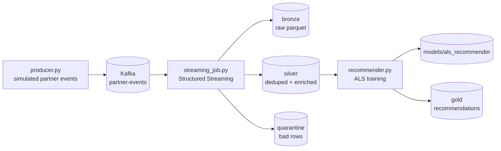

# Partner Product Pipeline — Spark Streaming + ML Recommendations

Real-time ingestion of partner product feeds (views, clicks, purchases,
inventory updates) with Apache Kafka and Spark Structured Streaming,
plus a collaborative-filtering recommender trained with Spark MLlib (ALS).

This is a portfolio project: the "partner feeds" are simulated locally,
so the whole thing runs on one machine with Docker.

## Architecture



**Layers:**
- **Bronze** — raw parsed events, kept as an audit trail
- **Silver** — deduplicated on `event_id` (watermarked), enriched with
  category margin and revenue; feeds analytics and ML
- **Gold** — top-N product recommendations per user
- **Quarantine** — malformed rows, kept for debugging instead of dropped

## Tech stack

| Component   | Technology                          |
|-------------|-------------------------------------|
| Streaming   | Spark Structured Streaming 3.5      |
| Messaging   | Kafka (local via Docker)            |
| ML          | Spark MLlib ALS (collaborative filtering) |
| Storage     | Parquet (bronze/silver/gold)        |
| Language    | Python 3.11                         |
| Infra       | Docker Compose                      |

## Project structure

```
partner-product-spark-ml/
├── src/
│   ├── config.py          # all settings, env-var overrides
│   ├── producer.py        # simulated partner event generator -> Kafka
│   ├── streaming_job.py   # Kafka -> bronze/silver/quarantine (streaming)
│   └── recommender.py     # silver -> ALS model + recommendations (batch)
├── notebooks/
│   └── partner_analysis.ipynb
├── docker-compose.yml     # kafka, zookeeper, spark master/worker
├── requirements.txt
└── README.md
```

## Quickstart

**1. Start Kafka and Spark:**
```bash
docker compose up -d
```

**2. Install Python deps:**
```bash
pip install -r requirements.txt
```

**3. Produce events** (in one terminal):
```bash
python src/producer.py --rate 20 --duration 300
```

**4. Run the streaming job** (in another terminal):
```bash
spark-submit --packages org.apache.spark:spark-sql-kafka-0-10_2.12:3.5.1 \
  src/streaming_job.py
```

**5. Train the recommender** (after some events have landed in silver):
```bash
python src/recommender.py --top-n 10
```

**6. Explore:** open `notebooks/partner_analysis.ipynb`.

## Configuration

All settings live in `src/config.py` and can be overridden with
environment variables — no code edits needed to switch environments:

| Variable | Default | Purpose |
|---|---|---|
| `KAFKA_BOOTSTRAP` | `localhost:9092` | Kafka brokers |
| `EVENTS_TOPIC` | `partner-events` | Kafka topic |
| `SPARK_MASTER` | `local[*]` | `local[*]` or `spark://spark-master:7077` |
| `DATA_DIR` | `./data` | bronze/silver/gold output |
| `ALS_RANK` / `ALS_MAX_ITER` | `20` / `15` | ALS hyperparameters |

## Design decisions

- **Explicit schemas everywhere** — streaming jobs use a declared
  `StructType`, never `inferSchema`, so a bad partner record can't
  silently shift the schema.
- **Watermark + dedup on `event_id`** — partner replays and late data
  don't double-count revenue.
- **Quarantine sink** — malformed rows are kept for inspection rather
  than dropped, which is what you'd want when debugging a partner feed.
- **Implicit feedback for ALS** — views/clicks/purchases are weighted
  (1/2/5) into interaction strengths, the standard approach when you
  don't have explicit ratings.

## Sample output

Top-10 recommendations written to `data/gold/recommendations`
(one row per user with an array of recommended product ids), and
`models/metrics.json` with the test RMSE from the held-out split.

## Future work

- Time-based train/test split for the recommender (no lookahead)
- Real partner connectors (SFTP/API) replacing the simulator
- Serving layer (e.g. Redis) for low-latency recommendation lookup
- Delta Lake for ACID upserts on the silver layer

## License

MIT
